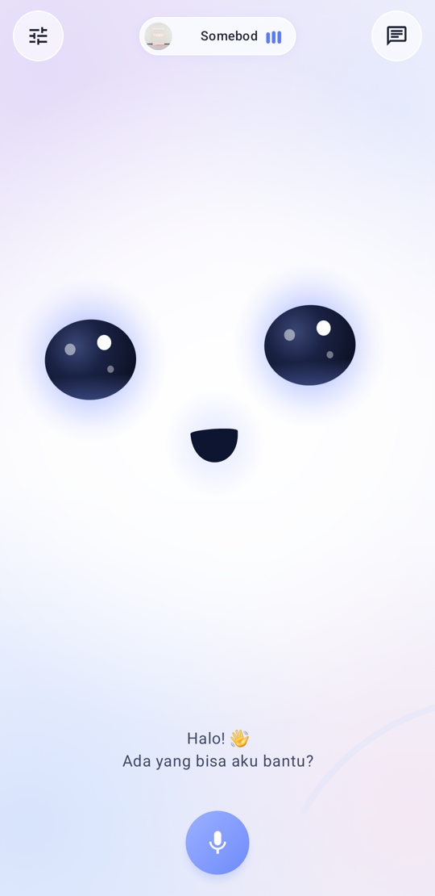
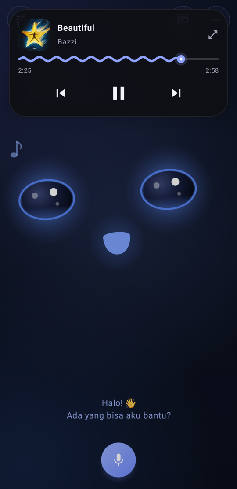
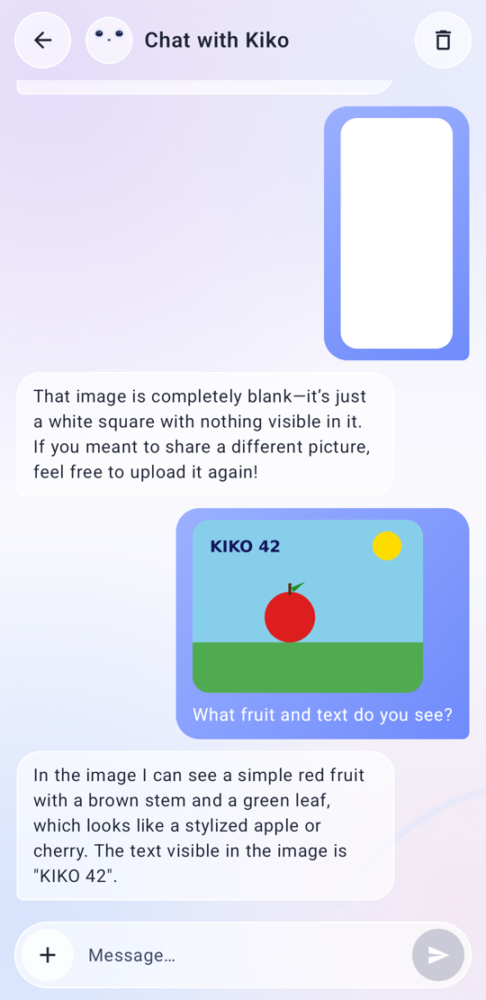
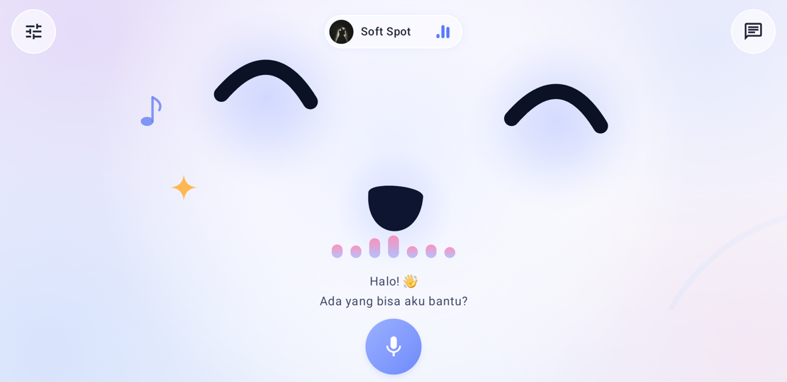
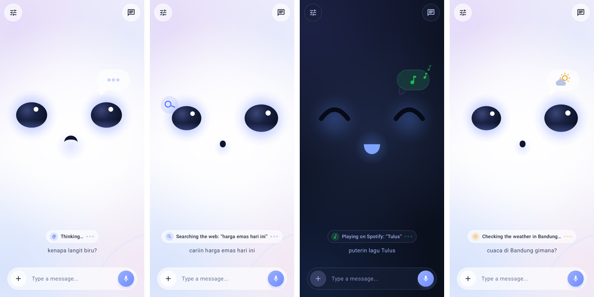
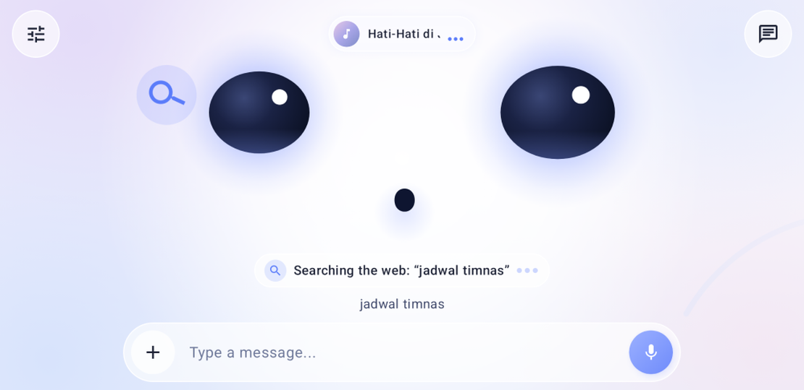

# Kiko Companion

A cute animated-face AI voice companion for Android. You can put your phone or tablet on a stand and talk to it. It's built with Kotlin and Jetpack Compose.

Kiko shows a simple face with two glossy eyes and a small mouth. It blinks, glances around, reacts to touch, the weather and music, and falls asleep when you leave it alone. You can talk to it hands-free with a wake word, or type in chat mode. All the "brains" (speech-to-text, the LLM with tool calling, text-to-speech) are cloud services you choose in **Settings**. The defaults are free, and most of them need no key at all.

<p align="center">
  
  
  
  
</p>
<p align="center">
  
  
</p>
<p align="center">
  
  
</p>

## Features

- **Voice chat.** Push the mic button or use the wake word. Speech is transcribed by Whisper (Groq by default), answered by an LLM with tool calling (`openai/gpt-oss-120b` on Groq by default), and spoken back while the mouth follows the audio level.
- **On-device wake word.** This uses [openWakeWord](https://github.com/dscripka/openWakeWord) models run with ONNX Runtime; the default is "Hey Jarvis". It works only while the app is in the foreground. You can set a custom `.onnx` model and the threshold.
- **Chat mode.** Text chat with saved history, Markdown replies, **image attachments** (needs a vision-capable model) and **`.txt` / `.md` files** as context.
- **Activity indicators.** You can always see what Kiko is doing: listening, transcribing, thinking, looking at an image, searching the web (with the query), reading a page, Spotify play/pause/resume/next/previous/now playing, weather, timers and alarms, opening apps, the time, dancing, getting ready to speak and loading lyrics. Each state has its own face expression, gaze and small animation (an orbiting magnifier for search, a thought bubble with dots, a sun and cloud, or music notes), plus a theme-aware status pill with an icon and label in English or Indonesian. The pill sits above the caption, well below the Dynamic Island. In chat mode the same state appears as an inline status row, and finished replies list the steps (e.g. *Web · "query"*, *Page · host*) above the source links. States follow the real tool start/end/error events, failed tools show a red "Didn't work" state, and with system animations turned off everything is drawn static.
- **Dynamic Island now-playing.** A pill at the top of the screen expands into a mini player. There is also a full player screen with album-art colors and **synced lyrics** (through the spotapi backend).
- **Spotify control.** Three modes:
  - Local: intents and media keys, with no setup.
  - Official Spotify Web API: OAuth PKCE; playback control needs Premium.
  - A self-hosted **[spotapi-backend](https://github.com/ejatapibeda/spotapi-backend)** (FastAPI + Docker, GPL-3.0). It adds now-playing details, devices and lyrics, and works without Premium. Setup: [docs/spotify.md](docs/spotify.md) and the backend's README.
- **Weather-reactive face.** Rain, cold and heat change the ambient effects (rain streaks, drifting six-armed snowflakes, warm haze) and give funny reactions (sneezing, shivering, overheating). Weather comes from Open-Meteo using coarse location or an IP-based fallback. No key is needed.
- **Dance mode.** When music plays, the face bounces on the beat with music notes, EQ bars, a beat halo and sparkles. You can also say "dance!" (the `face_dance` tool).
- **Sleep animation.** After a period of inactivity Kiko dozes off with closed eyes and floating "Z"s. A tap, a shake or the wake word wakes it up.
- **Touch and motion personality.** Taps, long-presses, rapid taps, shaking and tilting each trigger a different reaction, with optional haptics.
- **TTS fallback chain.**
  - Default: TikTok voices through the free `lazypy.ro` proxy.
  - If you set a TikTok `sessionid`, the official TikTok endpoint is used next.
  - Other providers: ElevenLabs or any OpenAI-compatible `/audio/speech`.
  - Android's built-in TTS is always the last fallback.
- **Mic processing.** Noise suppression, echo cancellation and automatic gain control (AGC), so Kiko doesn't hear its own voice, plus a **mic sensitivity** slider that scales the gain and the speech/wake-word thresholds.
- **Web search.**
  - The default chain needs no key: Tavily keyless → your own SearXNG → DuckDuckGo → Wikipedia.
  - Optional keyed providers: Tavily, Exa, Brave, Serper, LangSearch, Groq `browser_search`.
  - In voice mode, answers are short and URLs are never read aloud. In chat mode, sources are shown as links.
- **Other tools.** Timers and alarms (through the system Clock app), opening apps, the date and time, and the weather.
- **Languages.** English and Indonesian (UI, prompts, STT/TTS defaults), chosen on first launch.
- **Privacy.** All keys are stored encrypted (EncryptedSharedPreferences with an Android Keystore key). No keys are bundled in the APK, and keys are never logged.

## Requirements

- Android 8.0+ (**minSdk 26**, target/compile SDK 34)
- ABIs: **arm64-v8a**, **armeabi-v7a** and **x86_64**. A universal APK is also built.
- Permissions:
  - Microphone (required for voice).
  - Coarse location (optional, for weather; it falls back to IP-based location).
  - Internet.
- A free [Groq](https://console.groq.com/keys) API key, or any other OpenAI-compatible LLM endpoint.
- Optional, for the spotapi Spotify mode (lyrics, devices, no Premium): a self-hosted backend: https://github.com/ejatapibeda/spotapi-backend

## Build

You need JDK 17 and the Android SDK (platform 34). Create `local.properties` with `sdk.dir=/path/to/Android/sdk`, or set `ANDROID_HOME`.

```bash
./gradlew assembleDebug        # per-ABI APKs + app-universal-debug.apk in app/build/outputs/apk/debug/
./gradlew assembleCompact      # smaller debug build (R8 + resource shrinking) in app/build/outputs/apk/compact/
./gradlew testDebugUnitTest    # unit tests (logic, parsers, cloud pipeline with MockWebServer)
./gradlew recordPaparazziDebug # re-render face/player/settings snapshots into app/src/test/snapshots/images/
```

Install with `adb install -r app/build/outputs/apk/debug/app-arm64-v8a-debug.apk`. Use `armeabi-v7a` for older 32-bit devices.

See [docs/development.md](docs/development.md) for tests, live tests, debug-only adb hooks and the code layout.

## First-run setup

1. Open the app and pick **English** or **Bahasa Indonesia**.
2. Allow **microphone** access, and location if you want local weather.
3. Tap the **settings** icon (top-left) → **Brain (LLM)** → paste your Groq API key → **Save**. STT uses the same key automatically.
4. Say **"Hey Jarvis"**, or tap the mic, and ask something like "what's the weather?" or "search for the latest news about …".
5. Optional:
   - Choose a TTS voice.
   - Set up Spotify (see [docs/spotify.md](docs/spotify.md); for the spotapi mode, deploy [spotapi-backend](https://github.com/ejatapibeda/spotapi-backend) first).
   - Pick a web search provider.
   - Set a vision model for image chat.
   - Adjust mic sensitivity and noise suppression.

## Documentation

- [docs/services.md](docs/services.md) explains every external API and service the app uses: what it does, whether it needs a key, the free limits and where to configure it.
- [docs/spotify.md](docs/spotify.md) covers the Spotify modes and the self-hosted backend ([ejatapibeda/spotapi-backend](https://github.com/ejatapibeda/spotapi-backend)).
- [docs/development.md](docs/development.md) covers building, testing, debug hooks and the architecture.

## Credits and licenses

- The app code is licensed under the [MIT](LICENSE) license.
- The **wake-word models** in `app/src/main/assets/wakeword/` come from [openWakeWord](https://github.com/dscripka/openWakeWord). The feature models (`melspectrogram.onnx`, `embedding_model.onnx`) are Apache-2.0. The pre-trained `hey_jarvis_v0.1.onnx` model is licensed **CC BY-NC-SA 4.0 (non-commercial)**. Replace it with your own model if you need commercial use.
- The optional Spotify backend, [spotapi-backend](https://github.com/ejatapibeda/spotapi-backend) (GPL-3.0), wraps [SpotAPI](https://github.com/ejatapibeda/SpotAPI) (GPL-3.0). It runs as a separate server, and the app only talks to it over HTTP.
- TikTok TTS, the `lazypy.ro` proxy, Tavily keyless and DuckDuckGo HTML are unofficial or free-tier services. They may change or rate-limit at any time, so the app always has a fallback.

---

## Bahasa Indonesia (ringkas)

**Kiko** adalah asisten suara AI berwajah lucu untuk Android (Kotlin + Jetpack Compose). Panggil dengan wake word "Hey Jarvis" atau tombol mic, atau pakai mode chat (bisa kirim gambar & file .txt). Fitur: indikator aktivitas (wajah, pil status, dan baris status di chat menunjukkan Kiko lagi mikir, nyari di web, memutar Spotify, cek cuaca, dll), Dynamic Island + lirik, kontrol Spotify, wajah bereaksi terhadap cuaca, joget saat musik, animasi tidur, rantai TTS (TikTok gratis → Android TTS), peredam bising + sensitivitas mic, dan pencarian web gratis tanpa key (Tavily keyless → SearXNG → DuckDuckGo → Wikipedia).

Mulai cepat: build dengan `./gradlew assembleDebug`, pasang APK, pilih bahasa, buka **Pengaturan → Otak (LLM)**, tempel API key Groq gratis dari https://console.groq.com/keys, lalu **Simpan**. Penjelasan setiap layanan ada di [docs/services.md](docs/services.md), dan setup Spotify ada di [docs/spotify.md](docs/spotify.md). Backend Spotify self-hosted: https://github.com/ejatapibeda/spotapi-backend
